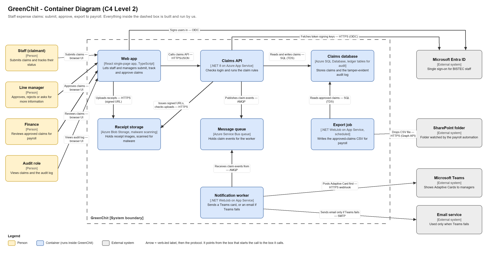
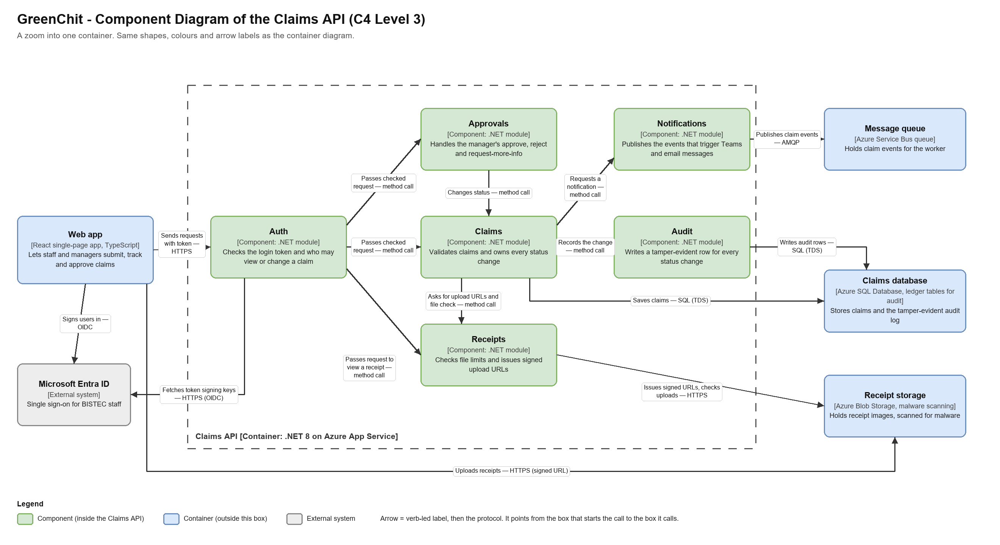

# GreenChit — Architecture Design Pack

**Author:** Thevinu · **Status:** Draft · **Part:** Deliverable 1 (container and component diagrams)

## 1. System Context

GreenChit is an internal BISTEC tool for staff expense claims. A staff member submits a claim with a category, date, amount in LKR, description and one to five receipt images. Their line manager gets a Teams message and approves, rejects or asks for more information. Finance reviews the approved claims, and a CSV of them is dropped in a SharePoint folder that the payroll automation reads. The audit role can view claims and a tamper-evident audit log of every status change, kept for 7 years. People sign in with Microsoft Entra ID. Everything runs on Azure.

## 2. Containers (C4 Level 2)

A **container** is a piece that runs or stores data on its own, such as a web app, an API, a database or a queue. It is not a Docker container.

Source file: `Thevinu-day4-greenchit-design/diagrams/container-diagram.drawio`

**How to read the notation:** each box has a name, the technology in square brackets, and one sentence of responsibility. Each arrow has a verb and a protocol, and it points from the box that starts the call to the box it calls. A person has no protocol, so the arrows from people say "browser UI": they use the Web app on screen. The Web app calls the Claims API over HTTPS.

**Inside GreenChit (built and run by us)**

| Container | Technology | Responsibility |
|-----------|------------|----------------|
| Web app | React single-page app, TypeScript | Lets staff and managers submit, track and approve claims. |
| Claims API | .NET 8 on Azure App Service | Checks login and runs the claim rules. |
| Claims database | Azure SQL Database, ledger tables for audit | Stores claims and the tamper-evident audit log. |
| Receipt storage | Azure Blob Storage, malware scanning | Holds receipt images. The web app uploads to it with a signed URL. |
| Message queue | Azure Service Bus queue | Holds claim events so the API does not wait for Teams or email. |
| Notification worker | .NET WebJob on App Service | Reads the queue and posts a Teams card. It sends an email only if Teams fails, never both. |
| Export job | .NET WebJob on App Service, scheduled | Writes the CSV of approved claims for payroll. |

**Outside GreenChit (grey on the diagram)**

| System | Why it is there |
|--------|-----------------|
| Microsoft Entra ID | Single sign-on for BISTEC staff. |
| Microsoft Teams | Shows the Adaptive Card to the manager. |
| Email service | Used only when Teams fails. |
| SharePoint folder | Holds the CSV. The payroll automation watches it. |

**People (yellow):** Staff (claimant), Line manager, Finance, Audit role. Each points to the Web app, because that is the only container they use.

**Assumptions to confirm in the ADRs**
- **Hosting:** the Claims API and the two WebJobs run on App Service. This is proposed in ADR-0002. If it changes to Container Apps, the WebJobs become their own containers. They stay separate boxes either way.
- **Database:** Azure SQL with ledger tables is proposed in ADR-0003, because the audit log must be tamper-evident and kept for 7 years.
- **Receipts:** malware scanning on upload is proposed in ADR-0004. What happens to a file that fails the scan is decided there.
- **Web app:** the brief names no framework. React with TypeScript is my choice and is easy to change. The files are served from the same App Service.
- **Export:** the brief says Finance "can export". I drew a scheduled job. If Finance must trigger it, the Web app calls the Claims API, which starts the job.
- **Export job reads the database directly,** not through the API. It is a trusted internal job, so this is acceptable, but it skips the API's checks on who may see a claim.
- **The queue arrow:** the worker pulls events from the queue, so the arrow starts at the worker.

## 3. Components (C4 Level 3) for the Claims API

A **component** is one part inside a container, with one job. These are sections of the API's code, not separate programs.

Source file: `Thevinu-day4-greenchit-design/diagrams/component-diagram.drawio`

The notation is the same as in Section 2. Green boxes are components inside the Claims API. Blue and grey boxes are containers and systems from the container diagram, with the same names and technologies.

| Component | Responsibility |
|-----------|----------------|
| Auth | Checks the login token from Entra ID and decides who may view or change a claim (only the claimant, the line manager, Finance and the audit role may view it). It checks the token's signature using the signing keys it fetches from Entra ID. |
| Claims | Validates a claim (category, date, amount, description) and owns every status change: Draft, Submitted, Approved, Rejected, Paid. When a claim has receipts, it asks Receipts for the upload URLs and for the check that the files arrived. |
| Approvals | Handles the manager's three choices: approve, reject, or ask for more information. It asks Claims to change the status. |
| Receipts | Checks the limits (10 MB per file, 5 files per claim), issues signed upload URLs for Receipt storage, and checks that all files arrived before a claim is submitted. A signed URL is a web address that allows one upload and expires after a few minutes. The Web app uploads the photo straight to Receipt storage with it, so the photo never passes through the API. |
| Notifications | Publishes the events that lead to a Teams card or an email. |
| Audit | Writes a row for every status change: who, when, and why if it was rejected. |

How to read the arrows:
- **Entra ID:** both connections from the container diagram appear here too. The Web app signs the user in to get a token, and Auth only fetches Entra's signing keys to check that token.
- **Auth first:** every request from the Web app goes through Auth.
- **Claims owns the status:** Claims is the only component that changes a claim's status, so Audit and Notifications are called from one place.
- **Receipts:** Claims calls it while a claim is saved and submitted. Auth passes a request to it directly only when someone wants to view a receipt.
- **Receipt upload:** the Web app uploads receipts straight to Receipt storage with the signed URL (the arrow along the bottom). That upload never passes through the Claims API.

**Open risk:** Claims saves to the database and Notifications publishes to the queue as two separate steps. If the API fails between them, a claim could be saved with no notification sent. A common fix is to write the event to the database in the same transaction and send it to the queue afterwards (an outbox). This is a candidate for the fifth ADR.

## 4. Reading order

Read the pack in this order. It takes about 10 minutes.

1. **Section 1** gives the problem and the people involved.
2. **The container diagram.** Start on the left with the people, then follow Nimal's claim from the Web app. The Web app calls the Claims API, the API saves to the Claims database and issues a signed URL, and the receipt goes straight to Receipt storage. The API then publishes an event to the Message queue, and the Notification worker picks it up and sends the Teams card, or an email only if Teams fails. Finish with the Export job, which writes the CSV to SharePoint. Arrow labels read as "verb — protocol".
3. **The container table and assumptions.** Check that every box in the diagram has a technology and one job, and read which choices are still open.
4. **The component diagram.** It zooms into the Claims API only. Follow one request: Auth checks it, then it goes to Claims or Approvals. Claims saves to the database, asks Receipts for the upload URLs, and calls Audit and Notifications. The outside boxes are the containers from step 2 and have the same names.
5. **The component table and the open risk.** Check that each component has one sentence of responsibility.
6. **The journey over time:** the sequence diagrams in `Thevinu-day4-greenchit-design/diagrams/sequence-submit-approve.md` (submit and approve, plus two error paths).

*Drafted with AI assistance (Claude). Checked against the Day 4 brief by Thevinu.*
