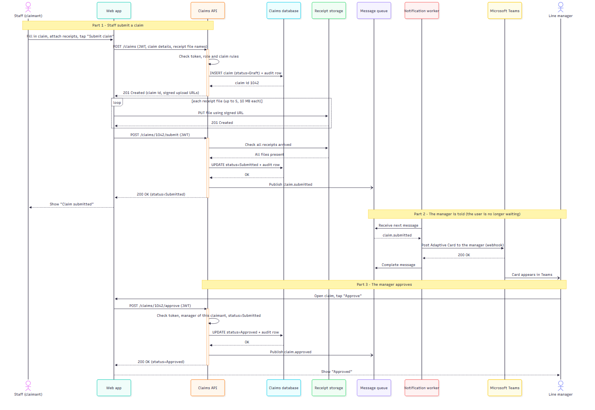
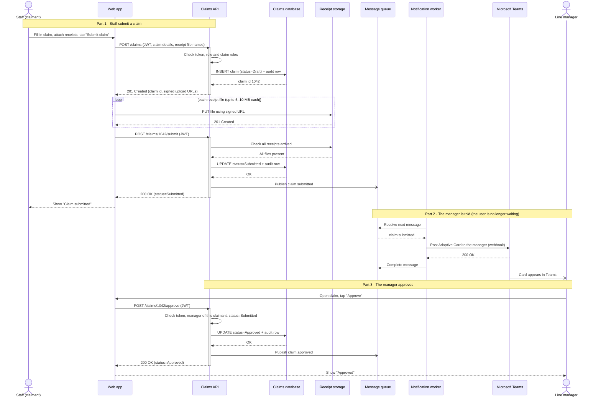
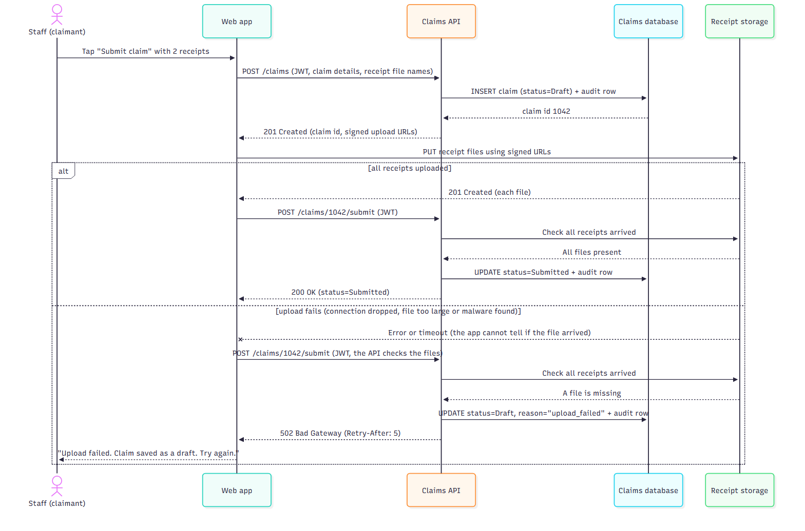
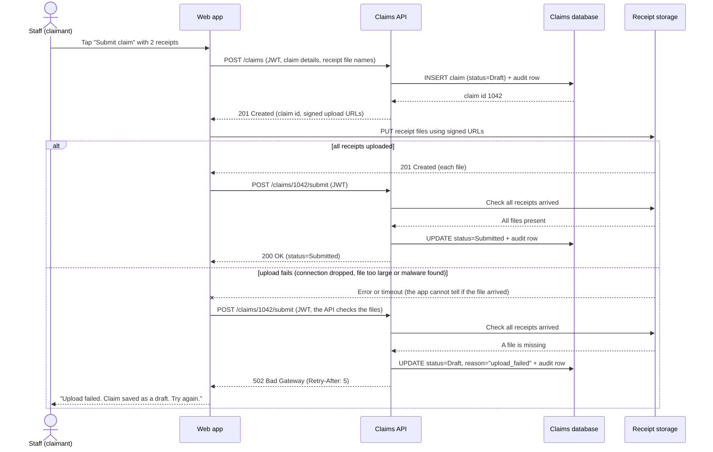
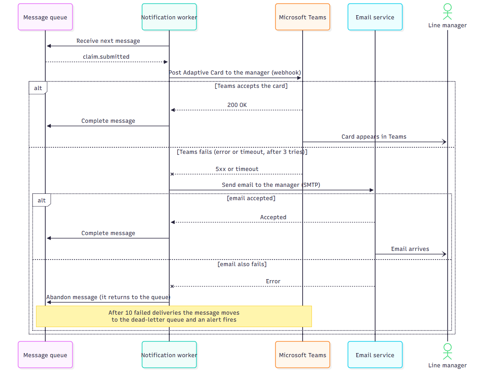
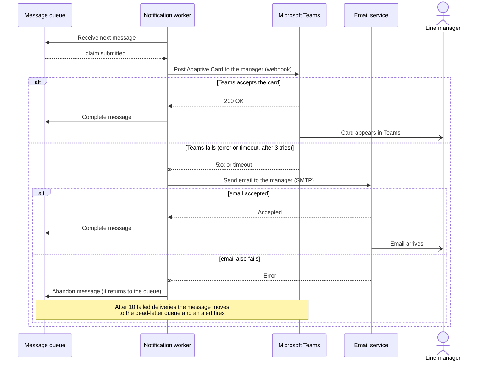

# Sequence — Submit and Approve a Claim

**Author:** Thevinu · **Status:** Draft · **Part:** Deliverable 2 (sequence diagrams)

A sequence diagram shows one user journey in time order, from top to bottom. Each vertical line is one participant. Every participant name is the same as the box name in the container diagram (`Thevinu-day4-greenchit-design.md`).

## How to read the arrows

| Arrow | Meaning | Example |
|-------|---------|---------|
| Solid line, closed head | **Synchronous.** The caller waits for the answer. | `Web app` sends `POST /claims` and waits |
| Dashed line, closed head | The **return** to a synchronous call. | `201 Created` |
| Solid line, open head | **Asynchronous.** The sender does not wait. | `Publish claim.submitted` to the Message queue |
| Dashed line with a cross | A **failed** call or an error. | Receipt upload times out |
| `alt` box | Either-or branches. The error paths sit here. | Teams works, or Teams fails |

## 1. Happy path

The staff member submits a claim with receipts. The manager is told and approves.

What to notice:
- **Parts 1 and 3 are synchronous.** The user waits and gets an answer. The claim is saved as a Draft first, and becomes Submitted only after the receipts have arrived.
- **The receipt files go straight to Receipt storage** with a signed URL. They do not pass through the Claims API.
- **Part 2 is asynchronous.** The Claims API publishes the event and replies to the user at once. The Notification worker tells the manager later.

## 2. Error path: the receipt upload fails after the claim was created

What to notice:
- The claim was saved as a Draft before the upload started, so nothing the user typed is lost.
- On failure the claim goes back to `Draft` with the reason `upload_failed`, the audit log records it, and the user gets `502` with `Retry-After`. The user can try again without retyping.

## 3. Error path: Teams fails, so the email is sent

What to notice:
- The email is sent **only** if Teams fails, never both.
- If the email also fails, the message returns to the queue and is tried again. After 10 failed deliveries it moves to the dead-letter queue and an alert fires, so a lost notification is never silent.

## Assumptions

- **Draft first.** The claim is saved as a Draft, the receipts are uploaded, and a second call (`/submit`) makes it Submitted. This is how the design lets an upload fail without losing the claim.
- **Receipt check.** The Claims API asks Receipt storage whether all files arrived before it accepts the submit. The container diagram arrow is labelled "Issues signed URLs, checks uploads".
- **`502` for a failed upload** follows the brief's example. A `409` or `422` would also be reasonable.
- **Retries.** Three tries on Teams, and 10 delivery attempts before the dead-letter queue, are my starting numbers. They can change in a later ADR.
- **Not shown:** the sign-in with Entra ID happens before this journey. The token in each request is the `JWT`. The approved claim reaching payroll is the Export job, a separate journey.
- The worker also tells the claimant when the claim is approved. It works the same way as the manager's notification, so it is not repeated.
